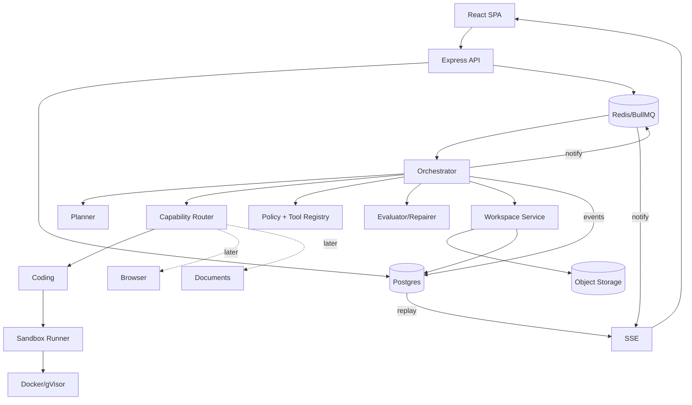

# Architecture

## 1. Principles
1. **One orchestrator, many capabilities.** Orchestrator owns task state; capabilities do the work.
2. **Providers on demand.** No Docker unless code must run.
3. **Workspace is the source of truth.** Sandboxes are disposable.
4. **Policy before execution.** Model output is an untrusted proposal; server policy decides.
5. **Evidence-based completion.** Done only when tests/checks prove success criteria.
6. **Recoverable.** State, events, and checkpoints are persisted.
7. **Provider abstraction.** Orchestrator never depends on Docker directly.

## 2. Components

| Component | Tech | Role |
|---|---|---|
| Web client | React + Vite (SPA), TS | Task composer, timeline, file explorer/editor, logs, approvals. REST + SSE. |
| API | Express, TS, Zod | Auth, validation, rate limits, task/project/artifact APIs, SSE. Never runs untrusted code. |
| Worker | BullMQ + Redis | Runs the task state machine and agent loop. |
| Agent core | in worker | Planner, capability router, tool router, evaluator, repairer, context manager. |
| Capabilities | modules | Coding (MVP); browser, data, documents, automation later. |
| Providers | modules | Direct, Docker code, browser, document, data. |
| Workspace service | module | Versioned files, changesets, sync, export. |
| Postgres | Drizzle | Metadata, state, events, audit. |
| Object storage | S3 / MinIO | File blobs, logs, exports, artifacts. |
| Redis | | Queue, locks, rate limits, event notifications. Not a source of truth. |
| Observability | OpenTelemetry | Logs, metrics, traces. |

Start as a modular monolith (separate API and worker processes).

## 3. Key mechanisms

**Task creation is a two-system write (Postgres + Redis).** Insert the task in Postgres first, then enqueue with BullMQ `jobId = taskId` (idempotent). A reconciler every ~30s re-enqueues tasks stuck in `QUEUED`. Redis loss then never loses a task.

**Events.** Worker writes the event to Postgres (sequence from `tasks.last_event_seq`, same transaction as the state change), then notifies via Redis pub/sub. SSE replays from Postgres using `Last-Event-ID`, then tails notifications.

**Worker leases.** A running task holds a lease (`lease_owner`, `lease_expires_at`) renewed by heartbeat. Expired leases are reclaimed and resumed from the last checkpoint.

**Cancellation.** API sets `cancel_requested_at` and signals Redis. Worker checks between steps, kills the sandbox, then marks `CANCELLED`.

**Auth.** Use a managed auth provider with cookie sessions (browser `EventSource` can't send auth headers). Because the React SPA is a separate app, serve it and the API under one origin (reverse proxy, or Vite dev proxy locally) so cookies are same-site. Use `HttpOnly`, `Secure`, `SameSite=Lax` cookies plus CSRF protection on state-changing routes.

**Express notes.** Express has no built-in validation or async error handling: wrap every route in a validate-with-Zod middleware, use one central error handler returning the standard error shape, and keep handlers thin (logic in service modules) so the framework stays swappable. For SSE, disable response buffering/compression and send heartbeat comments every ~15s.

## 4. Workspace model
- **Project workspace:** versioned files, owned by a user.
- **Task working copy:** snapshot copied into the sandbox.
- **Changeset:** create/update/delete operations with hashes, diffed from the working copy against the base snapshot.
- **Sync:** validate (paths, sizes, types) → apply as a new immutable version using compare-and-swap on the project's current version.
- **Conflicts:** if the project moved since the base version, apply only if changed paths don't overlap; otherwise mark the changeset `conflicted`, keep it, and let the user decide. No auto-merge in MVP.
- **Blobs:** content-addressed per project (`projects/{id}/blobs/{sha256}`).

## 5. Sandbox model
- Files are copied in and out (tar with size limits). No host bind mounts. Reject symlinks that escape.
- **Install phase:** network only through an allowlisted package proxy; `--ignore-scripts` by default.
- **Run/test phase:** network off.
- Non-root, read-only root FS where practical, CPU/memory/PID/disk/time limits.
- No Docker socket or secrets inside. LLM keys stay in the worker, never in the sandbox.
- **Where it runs:** the worker should not hold a Docker socket on a shared host. Use a small sandbox-runner service on a dedicated host (or rootless Docker). Local dev can use plain Docker.
- **Before outside users:** gVisor or Firecracker, plus quotas.

## 6. Security
- Tenant checks on every project, task, file, artifact route; add Postgres RLS where practical.
- Tool calls are validated by schema, permission, path, network, budget.
- Treat all tool output, file contents, and web content as untrusted (prompt-injection risk).
- Secrets only in a secrets manager; short-lived scoped credentials if ever needed.
- Approvals for destructive, external, costly, or deploy actions. An approval is bound to the exact action (hash) and expires.
- Audit tool calls, approvals, workspace changes, external effects.

## 7. Agent reliability rules
- Evaluator compares evidence to the plan's success criteria; "tests passed" requires tests actually ran.
- Repairer may not delete, skip, or weaken tests to pass; such changes are flagged.
- Same error signature twice → stop and report.
- Prompt and model versions are recorded per run. A golden-task eval suite gates prompt/model changes.

## 8. Tech choices

| Area | Choice |
|---|---|
| Frontend | React.js + Vite, TypeScript, Tailwind, React Router, TanStack Query |
| API | Express, TypeScript, Zod (validation middleware), Pino + pino-http (logs, request IDs), helmet, express-rate-limit |
| Orchestration | Custom state machine |
| LLM | Provider adapter, structured outputs |
| Queue | Redis + BullMQ |
| DB | Postgres + Drizzle |
| Code execution | Docker (Node.js 22 image) |
| Storage | S3-compatible (MinIO locally) |
| Tests | Vitest + provider integration tests |
| Observability | OpenTelemetry |

## 9. MVP scope
1. Create project and task.
2. Build/modify a Node.js project.
3. Run in limited Docker sandbox.
4. Capture logs and test results.
5. Bounded repair.
6. Sync to persistent workspace.
7. Browse/edit files, download ZIP.

Post-MVP: Python/FastAPI, live preview, browser research, data, documents, GitHub, deployment.
