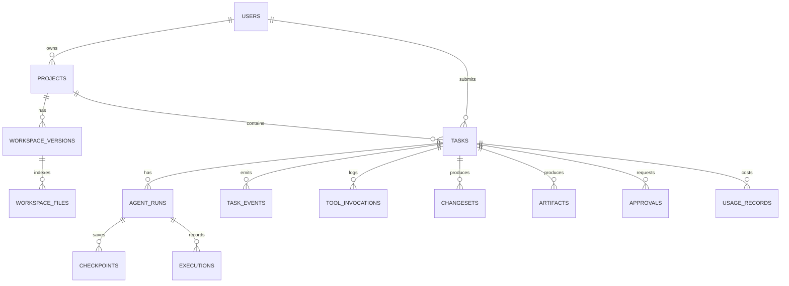

# Database Schema

## 1. Storage roles
- **Postgres:** all metadata, state, events, audit. Source of truth.
- **Object storage:** file blobs, ZIP exports, large logs, artifacts.
- **Redis:** queue, locks, rate limits, notifications. Never source of truth.

Conventions: UUID primary keys, `TIMESTAMPTZ` in UTC, foreign keys, tenant-aware access, migrations only.

## 2. Relationships

## 3. Tables

**users** — `id`, `email` (unique), `display_name`, `auth_provider_id` (unique), `created_at`, `updated_at`. No passwords stored.

**projects** — `id`, `owner_user_id` → users, `name`, `description`, `status` (default `active`), `current_workspace_version_id` → workspace_versions (deferrable FK), `created_at`, `updated_at`.

**tasks**
- `id`, `user_id` → users, `project_id` → projects (null until assigned), `prompt`, `status`
- `task_type`, `requested_capabilities` JSONB, `selected_providers` JSONB, `runtime` (approved registry ID, e.g. `node22`)
- `idempotency_key`, `request_hash`, `budget_json`
- `current_step_id`, `final_summary`, `stop_reason`
- `last_event_seq BIGINT DEFAULT 0`
- `lease_owner`, `lease_expires_at`, `cancel_requested_at`
- `created_at`, `started_at`, `completed_at`, `cleanup_done_at`
- `error_code`, `error_message`
- Unique `(user_id, idempotency_key)` where key is not null.
- Indexes: `(user_id, created_at DESC)`, `(project_id, created_at DESC)`, `(status, created_at)`, `(lease_expires_at)` for status in running states.

**agent_runs** — `id`, `task_id` (cascade), `attempt`, `state`, `plan_json`, `model_provider`, `model_name`, `prompt_version`, `started_at`, `finished_at`. Unique `(task_id, attempt)`. An *attempt* is one full run after a resume; repair loops happen inside a run.

**checkpoints** (append-only) — `id`, `agent_run_id` (cascade), `seq`, `step_id`, `state_json`, `workspace_version_id`, `created_at`. Unique `(agent_run_id, seq)`. Resume from the highest `seq`.

**task_events** — `id` identity, `task_id` (cascade), `sequence_number`, `event_type`, `payload_json`, `created_at`. Unique `(task_id, sequence_number)`. Sequence comes from `tasks.last_event_seq`, incremented in the same transaction.

**tool_invocations** — `id`, `task_id`, `agent_run_id`, `tool_name`, `args_summary` JSONB (redacted), `policy_decision` (`allowed`/`denied`/`needs_approval`), `result_status`, `execution_id` (nullable), `started_at`, `finished_at`.

**executions** — `id`, `task_id`, `agent_run_id`, `provider_type`, `provider_session_id`, `operation`, `input_summary`, `status`, `exit_code`, `stdout_storage_key`, `stderr_storage_key`, `result_json`, `resource_usage_json` (peak CPU/mem/disk), `duration_ms`, `started_at`, `finished_at`. No secrets or raw env.

**workspace_versions** — `id`, `project_id` (cascade), `version_number`, `parent_version_id`, `created_by_task_id`, `created_by_user_id`, `source` (`task`/`user_edit`/`restore`), `created_at`. Unique `(project_id, version_number)`. Immutable.

**workspace_files** — `id`, `workspace_version_id` (cascade), `path`, `blob_storage_key`, `content_hash`, `size_bytes`, `mime_type`. Unique `(workspace_version_id, path)`. This table *is* the manifest (no separate manifest object). Paths normalized; no absolute paths, traversal, or escaping symlinks.

**changesets** — `id`, `task_id`, `base_version_id`, `result_version_id` (null until applied), `status` (`pending`/`applied`/`conflicted`/`rejected`), `operations_json` (paths, op, hashes), `rejection_reason`, `created_at`. Keeps failed changesets for inspection.

**artifacts** — `id`, `task_id`, `project_id`, `kind` (`export`/`report`/`log`/`other`), `status` (`pending`/`ready`/`failed`), `filename`, `storage_key`, `mime_type`, `size_bytes`, `content_hash`, `expires_at`, `created_at`.

**approvals** — `id`, `task_id`, `requested_action`, `action_hash`, `reason`, `details_json`, `status` (`pending`/`approved`/`rejected`/`expired`), `requested_at`, `expires_at`, `resolved_at`, `resolved_by_user_id`, `comment`.

**usage_records** — `id`, `task_id`, `agent_run_id`, `kind` (`llm`/`compute`/`storage`), `provider`, `model`, `input_tokens`, `output_tokens`, `cost_micros`, `created_at`. Needed for budgets and quotas.

**audit_logs** — `id`, `actor_user_id`, `task_id`, `project_id`, `action`, `target`, `details_json` (redacted), `ip`, `created_at`. Append-only.

## 4. Later tables
`organizations`, `organization_members`, `project_members`, `secrets_metadata` (references only), `provider_sessions`.

## 5. Rules
- Update task status and insert its event in one transaction.
- Project head moves only via compare-and-swap: `UPDATE projects SET current_workspace_version_id = $new WHERE id = $id AND current_workspace_version_id = $base`.
- Enforce ownership in service code, plus RLS where practical.
- No large file content in Postgres.
- Retention policies for logs, events, and temporary artifacts.
